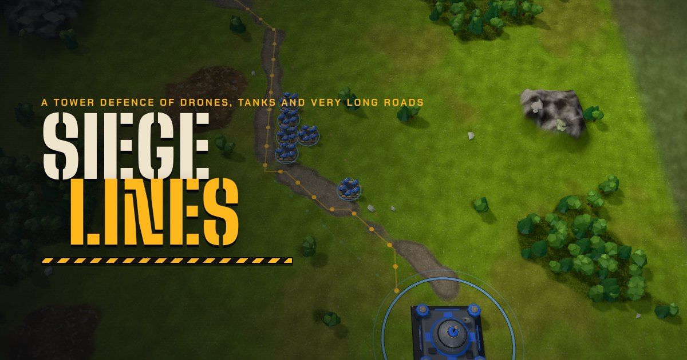

# Siege Lines

A tower defence of drones, tanks and very long roads.

**Play it in your browser: https://rosario.github.io/siege-lines/**

This repository holds the built game that GitHub Pages serves. It updates automatically whenever the game changes.

Siege Lines is built on [Battle Drones](https://github.com/simonw/battledrones) by Simon Willison, under the Apache License 2.0. The `licenses/` folder holds that licence, the NOTICE, and the licences of three.js (MIT) and the two fonts (SIL Open Font License).
